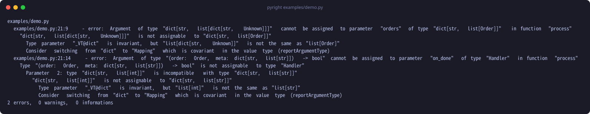
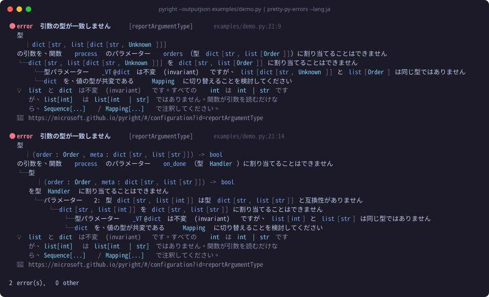
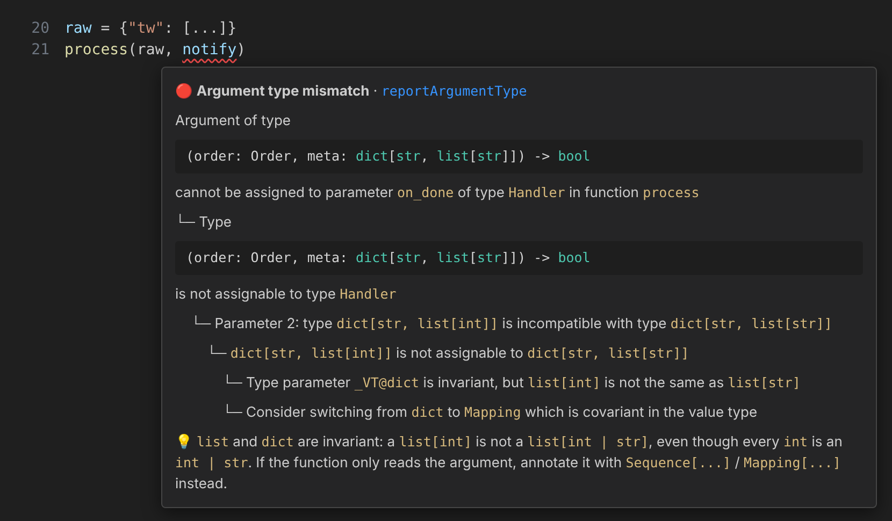

<div align="center">


# pretty-py-errors

**Python の型エラーを読みやすく。VS Code とターミナルに対応。**

Pyright · Pylance · basedpyright · mypy

[](https://github.com/Sharkeeeeeee/pretty-py-errors/actions/workflows/ci.yml)
[](https://marketplace.visualstudio.com/items?itemName=Sharkeeeeeee.pretty-py-errors)
[](LICENSE)
[](CONTRIBUTING.md)

[English](README.md) · [繁體中文](README.zh-TW.md) · [简体中文](README.zh-CN.md) · 日本語 · [한국어](README.ko.md)

</div>

---

## 目次

- [概要](#概要)
- [デモ](#デモ)
- [機能](#機能)
- [インストール](#インストール)
- [使い方](#使い方)
- [設定](#設定)
- [対応する型チェッカー](#対応する型チェッカー)
- [コントリビュート](#コントリビュート)
- [謝辞](#謝辞)
- [ライセンス](#ライセンス)

## 概要

Python の型チェッカーは優秀ですが、エラーメッセージは読みにくいものです。Pyright のエラーひとつが、ネストした `dict[str, list[tuple[...]]]` の長い 1 行と、5 段階にインデントされた説明で構成され、本当の原因は一番下に埋もれていることがあります。

**pretty-py-errors** はこれらのメッセージを整形します。

- 長い型を文中から取り出し、コードとして整形・ハイライト
- ネストした説明をツリーとして表示
- すべてのエラーに短いタイトル、修正のヒント、ルールのドキュメントへのリンクを付与
- **日本語**、繁體中文、简体中文、한국어で表示可能

**VS Code 拡張機能**（ホバー表示）と、`pyright` や `mypy` の出力をパイプで渡せる **CLI** を提供します。

## デモ

### 整形前



### 整形後（日本語）

```bash
pyright --outputjson examples/demo.py | pretty-py-errors --lang ja
```



### VS Code のホバー



<sub>ホバー画像は、同じエラーに対して拡張機能が実際に生成した Markdown から描画しています。</sub>

## 機能

| 機能 | VS Code | CLI |
| --- | :---: | :---: |
| 長い型を独立したコードブロックにしてハイライト | ✅ | ✅ |
| 長い型を括弧と `\|` Union で折り返し | ✅ | ✅ |
| ネストした説明をツリー表示 | ✅ | ✅ |
| ルールごとの短いタイトル（例:「引数の型が一致しません」） | ✅ | ✅ |
| よくあるエラーの修正ヒント（`None` チェック、invariance、パッケージ未検出など） | ✅ | ✅ |
| Pyright / mypy のルールドキュメントへのリンク | ✅ | ✅ |
| 日本語・繁體中文・简体中文・한국어への翻訳（70 種類のメッセージと全ルールのタイトル・ヒント） | ✅ | ✅ |
| Pyright の JSON／テキスト、mypy のテキスト／`--pretty`／JSON 出力に対応 | - | ✅ |
| Jupyter Notebook | ✅ | - |

## インストール

### VS Code 拡張機能

[VS Code Marketplace](https://marketplace.visualstudio.com/items?itemName=Sharkeeeeeee.pretty-py-errors) から **Pretty Python Errors** をインストールするか、拡張機能ビュー（`Ctrl+Shift+X`）で `Pretty Python Errors` を検索してください。コマンドラインからもインストールできます：

```bash
code --install-extension Sharkeeeeeee.pretty-py-errors
```

ソースからビルドしてインストールする場合：

```bash
git clone https://github.com/Sharkeeeeeee/pretty-py-errors.git
cd pretty-py-errors
npm install
npx @vscode/vsce package --no-dependencies
code --install-extension pretty-py-errors-*.vsix
```

**Pylance**（公式 Python 拡張機能に同梱）、**Pyright**、**basedpyright**、**Mypy Type Checker** 拡張機能と一緒に動作します。追加の設定は不要です。

### CLI

> npm パッケージの公開を準備中です。現在はソースから実行してください。

```bash
git clone https://github.com/Sharkeeeeeee/pretty-py-errors.git
cd pretty-py-errors
npm install && npm run build
npm link
```

Node.js 18 以上が必要です。

## 使い方

### VS Code

型チェッカーが示した波線にマウスを重ねると、整形された説明がホバーに表示されます。元のメッセージもそのまま残ります。

### CLI

```bash
pyright --outputjson | pretty-py-errors --lang ja
pyright | pretty-py-errors
mypy . | pretty-py-errors
mypy -O json . | pretty-py-errors
pretty-py-errors report.json
```

| オプション | 説明 |
| --- | --- |
| `--lang <code>` | 出力言語: `en`、`zh-TW`、`zh-CN`、`ja`、`ko`。既定値は環境変数 `LANG` から判定します。 |
| `--no-color` | 色を無効化します。`NO_COLOR` にも対応しています。 |
| `--no-hint` | 修正ヒントを表示しません。 |
| `--width <n>` | 長い型を折り返す幅（既定値 `60`）。 |
| `-h, --help` | ヘルプを表示します。 |

エラーがあると終了コード `1`、問題がなければ `0` で終了するため、CI や pre-commit フックでも使えます。引数が不正な場合は終了コード `2` で終了します。

## 設定

| 設定 | 既定値 | 説明 |
| --- | --- | --- |
| `prettyPyErrors.enable` | `true` | ホバーに整形したエラーを表示します。 |
| `prettyPyErrors.language` | `"auto"` | `auto`（VS Code の表示言語に従う）、`en`、`zh-TW`、`zh-CN`、`ja`、`ko`。 |
| `prettyPyErrors.showHints` | `true` | よくあるエラーの修正ヒントを表示します。 |
| `prettyPyErrors.inlineTypeLimit` | `40` | この文字数を超える型は独立したコードブロックで表示します。 |
| `prettyPyErrors.typeWidth` | `60` | 長い型を折り返す幅。 |

## 対応する型チェッカー

Pylance、Pyright、basedpyright、mypy。詳細は[英語版](README.md#supported-checkers)をご覧ください。

## コントリビュート

コントリビュートを歓迎します。特に翻訳の改善や修正ヒントの追加は大歓迎です。Pull Request の前に [CONTRIBUTING.md](CONTRIBUTING.md) をお読みください。

## 謝辞

このプロジェクトは、TypeScript で同じことを実現した [Yoav Balasiano](https://github.com/yoavbls) さんの [**pretty-ts-errors**](https://github.com/yoavbls/pretty-ts-errors) から着想を得ています。pretty-py-errors は Python エコシステム向けの独立した実装で、コードは共有していません。

## ライセンス

[MIT](LICENSE) © Sharkeeeeeee
