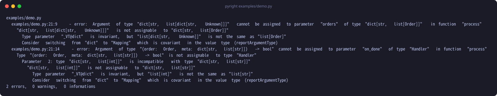
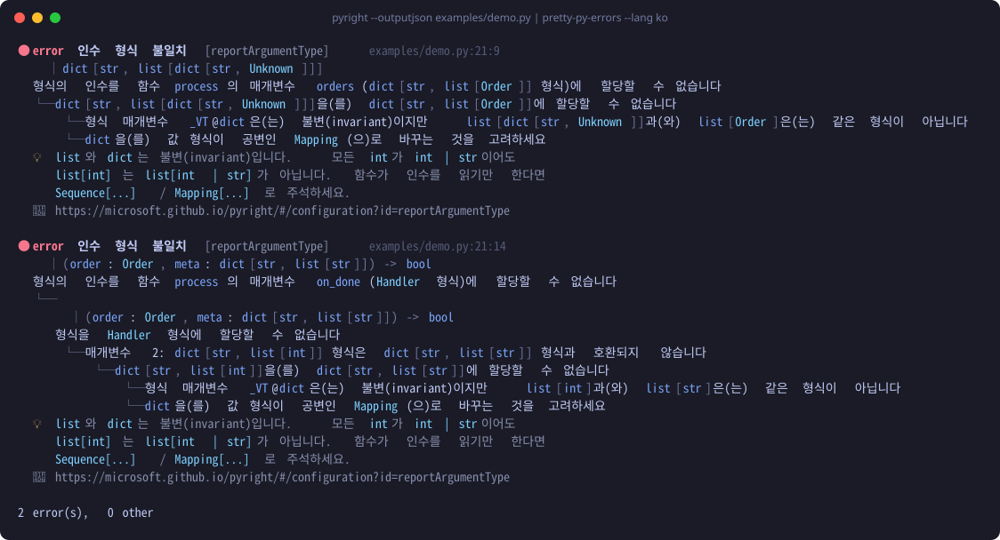
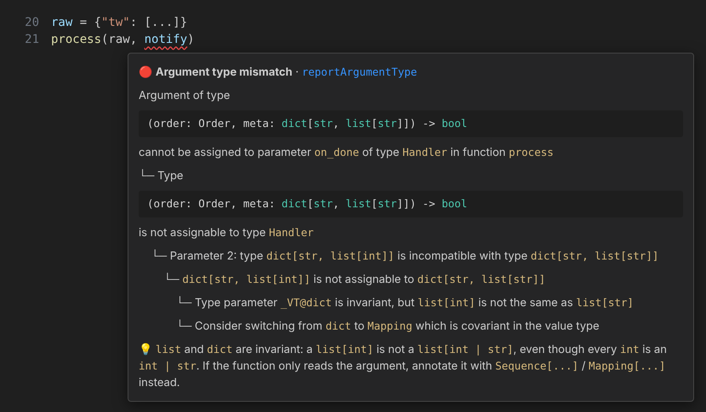

<div align="center">


# pretty-py-errors

**Python 형식 오류를 읽기 쉽게. VS Code와 터미널을 지원합니다.**

Pyright · Pylance · basedpyright · mypy

[](https://github.com/Sharkeeeeeee/pretty-py-errors/actions/workflows/ci.yml)
[](LICENSE)
[](CONTRIBUTING.md)

[English](README.md) · [繁體中文](README.zh-TW.md) · [简体中文](README.zh-CN.md) · [日本語](README.ja.md) · 한국어

</div>

---

## 목차

- [소개](#소개)
- [데모](#데모)
- [기능](#기능)
- [설치](#설치)
- [사용법](#사용법)
- [설정](#설정)
- [지원하는 형식 검사기](#지원하는-형식-검사기)
- [기여하기](#기여하기)
- [감사의 말](#감사의-말)
- [라이선스](#라이선스)

## 소개

Python 형식 검사기는 훌륭하지만 오류 메시지는 읽기 어렵습니다. Pyright 오류 하나가 중첩된 `dict[str, list[tuple[...]]]`로 이루어진 긴 한 줄과 다섯 단계로 들여쓴 설명으로 되어 있고, 진짜 원인은 맨 아래에 묻혀 있기도 합니다.

**pretty-py-errors**는 이런 메시지를 보기 좋게 정리합니다.

- 긴 형식을 문장에서 분리해 코드처럼 정렬하고 강조 표시
- 중첩된 설명을 트리 형태로 표시
- 모든 오류에 짧은 제목, 수정 힌트, 규칙 문서 링크 제공
- **한국어**, 繁體中文, 简体中文, 日本語로 표시 가능

**VS Code 확장**(마우스 호버)과 `pyright`나 `mypy` 출력을 파이프로 넘길 수 있는 **CLI**를 제공합니다.

## 데모

### 정리 전



### 정리 후 (한국어)

```bash
pyright --outputjson examples/demo.py | pretty-py-errors --lang ko
```



### VS Code 호버



<sub>호버 이미지는 같은 오류에 대해 확장이 실제로 생성한 Markdown으로 렌더링했습니다.</sub>

## 기능

| 기능 | VS Code | CLI |
| --- | :---: | :---: |
| 긴 형식을 별도 코드 블록으로 분리하고 강조 표시 | ✅ | ✅ |
| 긴 형식을 괄호와 `\|` 유니온 기준으로 줄바꿈 | ✅ | ✅ |
| 중첩된 설명을 트리로 표시 | ✅ | ✅ |
| 규칙별 짧은 제목(예: "인수 형식 불일치") | ✅ | ✅ |
| 자주 발생하는 오류의 수정 힌트(`None` 검사, invariance, 패키지 누락 등) | ✅ | ✅ |
| Pyright / mypy 규칙 문서 링크 | ✅ | ✅ |
| 한국어, 繁體中文, 简体中文, 日本語 번역(메시지 70종과 모든 규칙 제목 및 힌트) | ✅ | ✅ |
| Pyright JSON/텍스트, mypy 텍스트/`--pretty`/JSON 출력 지원 | - | ✅ |
| Jupyter Notebook | ✅ | - |

## 설치

### VS Code 확장

> Marketplace 게시를 준비 중입니다. 지금은 `.vsix` 파일로 설치하세요.

```bash
git clone https://github.com/Sharkeeeeeee/pretty-py-errors.git
cd pretty-py-errors
npm install
npx @vscode/vsce package --no-dependencies
code --install-extension pretty-py-errors-*.vsix
```

**Pylance**(공식 Python 확장에 포함), **Pyright**, **basedpyright**, **Mypy Type Checker** 확장과 함께 동작하며 추가 설정이 필요 없습니다.

### CLI

> npm 패키지 게시를 준비 중입니다. 지금은 소스에서 실행하세요.

```bash
git clone https://github.com/Sharkeeeeeee/pretty-py-errors.git
cd pretty-py-errors
npm install && npm run build
npm link
```

Node.js 18 이상이 필요합니다.

## 사용법

### VS Code

형식 검사기가 표시한 물결선 위에 마우스를 올리면 정리된 설명이 호버에 표시됩니다. 원래 메시지도 함께 유지됩니다.

### CLI

```bash
pyright --outputjson | pretty-py-errors --lang ko
pyright | pretty-py-errors
mypy . | pretty-py-errors
mypy -O json . | pretty-py-errors
pretty-py-errors report.json
```

| 옵션 | 설명 |
| --- | --- |
| `--lang <code>` | 출력 언어: `en`, `zh-TW`, `zh-CN`, `ja`, `ko`. 기본값은 `LANG` 환경 변수에서 판단합니다. |
| `--no-color` | 색상을 끕니다. `NO_COLOR`도 지원합니다. |
| `--no-hint` | 수정 힌트를 숨깁니다. |
| `--width <n>` | 긴 형식의 줄바꿈 너비(기본값 `60`). |
| `-h, --help` | 도움말을 표시합니다. |

오류가 있으면 종료 코드 `1`, 문제가 없으면 `0`으로 끝나므로 CI와 pre-commit 훅에서도 사용할 수 있습니다. 인수가 잘못되면 종료 코드 `2`로 끝납니다.

## 설정

| 설정 | 기본값 | 설명 |
| --- | --- | --- |
| `prettyPyErrors.enable` | `true` | 호버에 정리된 오류를 표시합니다. |
| `prettyPyErrors.language` | `"auto"` | `auto`(VS Code 표시 언어를 따름), `en`, `zh-TW`, `zh-CN`, `ja`, `ko`. |
| `prettyPyErrors.showHints` | `true` | 자주 발생하는 오류의 수정 힌트를 표시합니다. |
| `prettyPyErrors.inlineTypeLimit` | `40` | 이 길이를 넘는 형식은 별도 코드 블록으로 표시합니다. |
| `prettyPyErrors.typeWidth` | `60` | 긴 형식의 줄바꿈 너비. |

## 지원하는 형식 검사기

Pylance, Pyright, basedpyright, mypy. 자세한 내용은 [영어 문서](README.md#supported-checkers)를 참고하세요.

## 기여하기

기여를 환영합니다. 특히 번역 개선과 수정 힌트 추가를 환영합니다. Pull Request를 보내기 전에 [CONTRIBUTING.md](CONTRIBUTING.md)를 읽어 주세요.

## 감사의 말

이 프로젝트는 TypeScript에서 같은 일을 하는 [Yoav Balasiano](https://github.com/yoavbls)의 [**pretty-ts-errors**](https://github.com/yoavbls/pretty-ts-errors)에서 영감을 받았습니다. pretty-py-errors는 Python 생태계를 위한 독립적인 구현이며 코드를 공유하지 않습니다.

## 라이선스

[MIT](LICENSE) © Sharkeeeeeee
