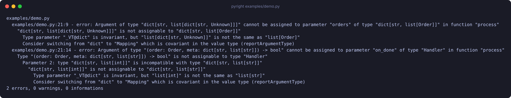
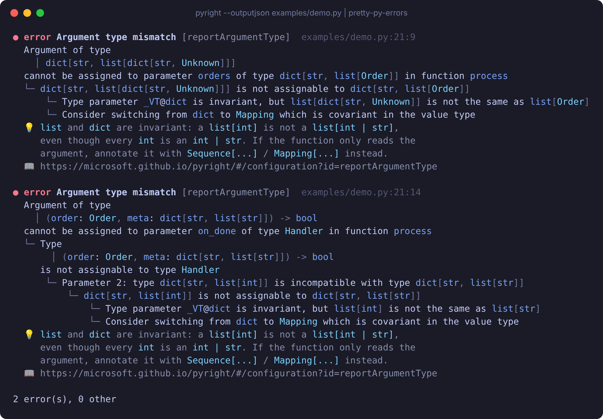
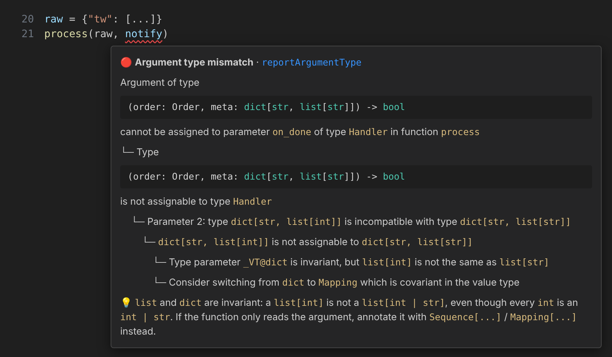

<div align="center">


# pretty-py-errors

**Make Python type errors pretty and human-readable, in VS Code and in your terminal.**

Pyright · Pylance · basedpyright · mypy

[](https://github.com/Sharkeeeeeee/pretty-py-errors/actions/workflows/ci.yml)
[](LICENSE)
[](CONTRIBUTING.md)

English · [繁體中文](README.zh-TW.md) · [简体中文](README.zh-CN.md) · [日本語](README.ja.md) · [한국어](README.ko.md)

</div>

---

## Table of Contents

- [Overview](#overview)
- [Demo](#demo)
- [Features](#features)
- [Installation](#installation)
- [Usage](#usage)
- [Configuration](#configuration)
- [Supported Checkers](#supported-checkers)
- [How It Works](#how-it-works)
- [Roadmap](#roadmap)
- [Contributing](#contributing)
- [Acknowledgements](#acknowledgements)
- [License](#license)

## Overview

Python's type checkers are excellent, but their messages are hard to read. A single Pyright error can be one long line of nested `dict[str, list[tuple[...]]]` types, followed by five levels of indented explanation, with the actual problem buried at the bottom.

**pretty-py-errors** reformats those messages so you can see the problem at a glance:

- long types are pulled out of the sentence and formatted like code,
- nested explanations are drawn as a tree,
- every error gets a short title, a fix hint and a link to the rule's documentation,
- and everything can be shown in **繁體中文, 简体中文, 日本語 or 한국어**.

It ships as a **VS Code extension** (hover) and a **CLI** you can pipe `pyright` or `mypy` output into.

## Demo

### Before

Raw `pyright` output:



### After: terminal

```bash
pyright --outputjson examples/demo.py | pretty-py-errors
```



### After: VS Code hover



<sub>The hover image is rendered from the extension's actual Markdown output for the same error.</sub>

### Other languages

```bash
pyright --outputjson examples/demo.py | pretty-py-errors --lang ja
```

Each localized README shows the output in its language: [繁體中文](README.zh-TW.md) · [简体中文](README.zh-CN.md) · [日本語](README.ja.md) · [한국어](README.ko.md).

All screenshots are generated from real Pyright output in [`test/fixtures`](test/fixtures) by `npm run docs`.

## Features

| Feature | VS Code | CLI |
| --- | :---: | :---: |
| Long types moved to their own formatted, syntax-highlighted block | ✅ | ✅ |
| Long types wrapped across lines at brackets and `\|` unions | ✅ | ✅ |
| Nested explanations rendered as a tree | ✅ | ✅ |
| Short title per rule (e.g. *Argument type mismatch*) | ✅ | ✅ |
| Fix hints for common errors (`None` narrowing, invariance, missing imports, …) | ✅ | ✅ |
| Link to the Pyright / mypy rule documentation | ✅ | ✅ |
| Translations into 繁體中文, 简体中文, 日本語 and 한국어 (70 message patterns, all rule titles and hints) | ✅ | ✅ |
| Works with Pyright JSON, Pyright text and mypy text output | n/a | ✅ |
| Jupyter notebooks | ✅ | n/a |

## Installation

### VS Code extension

> The Marketplace listing is in preparation. Until then, install from a `.vsix` file.

```bash
git clone https://github.com/Sharkeeeeeee/pretty-py-errors.git
cd pretty-py-errors
npm install
npx @vscode/vsce package --no-dependencies
code --install-extension pretty-py-errors-*.vsix
```

The extension works alongside **Pylance** (installed with the official Python extension), **Pyright**, **basedpyright** or the **Mypy Type Checker** extension. No extra setup is required.

### CLI

> The npm package is in preparation. Until then, run it from a clone.

```bash
git clone https://github.com/Sharkeeeeeee/pretty-py-errors.git
cd pretty-py-errors
npm install && npm run build
npm link            # makes `pretty-py-errors` available on your PATH
```

Requires Node.js 18 or later.

## Usage

### VS Code

Hover over any squiggly line reported by a supported checker. The prettified explanation appears in the hover, together with the original message.

### CLI

```bash
# Pyright (JSON output gives the best result)
pyright --outputjson | pretty-py-errors

# Pyright (plain text output)
pyright | pretty-py-errors

# mypy
mypy . | pretty-py-errors

# From a saved report, in Japanese
pretty-py-errors report.json --lang ja
```

| Option | Description |
| --- | --- |
| `--lang <code>` | Output language: `en`, `zh-TW`, `zh-CN`, `ja` or `ko`. Defaults to the `LANG` environment variable. |
| `--no-color` | Disable colors. `NO_COLOR` is also respected. |
| `--no-hint` | Hide fix hints. |
| `--width <n>` | Wrap long types at this width (default `60`). |
| `-h, --help` | Show help. |

The CLI exits with code `1` when at least one error is found, so it can be used in CI and pre-commit hooks.

## Configuration

| Setting | Default | Description |
| --- | --- | --- |
| `prettyPyErrors.enable` | `true` | Show prettified errors on hover. |
| `prettyPyErrors.language` | `"auto"` | `auto` (follow the VS Code display language), `en`, `zh-TW`, `zh-CN`, `ja` or `ko`. |
| `prettyPyErrors.showHints` | `true` | Show a short hint on how to fix common errors. |
| `prettyPyErrors.inlineTypeLimit` | `40` | Types longer than this are shown as a separate code block. |
| `prettyPyErrors.typeWidth` | `60` | Wrap long types at this width. |

## Supported Checkers

| Checker | Diagnostic source | Rule links |
| --- | --- | --- |
| [Pylance](https://marketplace.visualstudio.com/items?itemName=ms-python.vscode-pylance) | `Pylance` | Pyright configuration docs |
| [Pyright](https://github.com/microsoft/pyright) | `Pyright` | Pyright configuration docs |
| [basedpyright](https://github.com/DetachHead/basedpyright) | `basedpyright` | Pyright configuration docs |
| [mypy](https://github.com/python/mypy) | `Mypy` / `mypy` | mypy error code list |

## How It Works

```
diagnostic message ──► split rule code ──► translate (optional)
                                              │
                                              ▼
                     parse quoted code + indentation depth
                                              │
                         ┌────────────────────┴────────────────────┐
                         ▼                                         ▼
               Markdown renderer (hover)                 ANSI renderer (terminal)
```

The core in [`src/core`](src/core) has no dependency on VS Code and is shared by the extension and the CLI:

| Module | Responsibility |
| --- | --- |
| [`parse.ts`](src/core/parse.ts) | Splits messages into indented lines of text and quoted code. |
| [`prettyType.ts`](src/core/prettyType.ts) | Wraps long type expressions at brackets and unions. |
| [`i18n.ts`](src/core/i18n.ts) | Message-pattern translations. |
| [`rules.ts`](src/core/rules.ts) | Rule titles, fix hints and documentation links. |
| [`format.ts`](src/core/format.ts) | Markdown and ANSI renderers. |
| [`inputs.ts`](src/core/inputs.ts) | Parsers for Pyright JSON, Pyright text and mypy output. |

## Roadmap

- [ ] Publish to the VS Code Marketplace and Open VSX
- [ ] Publish the CLI to npm
- [x] Traditional Chinese, Simplified Chinese, Japanese and Korean translations
- [ ] Neovim integration via the shared core
- [ ] Ruff and Pyrefly diagnostics

Suggestions are welcome in [Issues](https://github.com/Sharkeeeeeee/pretty-py-errors/issues).

## Contributing

Contributions are welcome, especially new translations and fix hints. Please read [CONTRIBUTING.md](CONTRIBUTING.md) before opening a pull request.

## Acknowledgements

This project is inspired by [**pretty-ts-errors**](https://github.com/yoavbls/pretty-ts-errors) by [Yoav Balasiano](https://github.com/yoavbls), which does the same for TypeScript. pretty-py-errors is an independent implementation for the Python ecosystem and shares no code with it.

## License

[MIT](LICENSE) © Sharkeeeeeee
