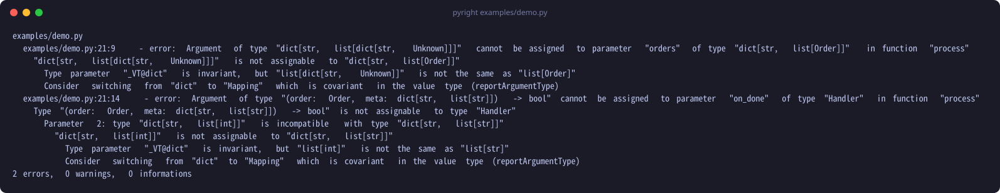
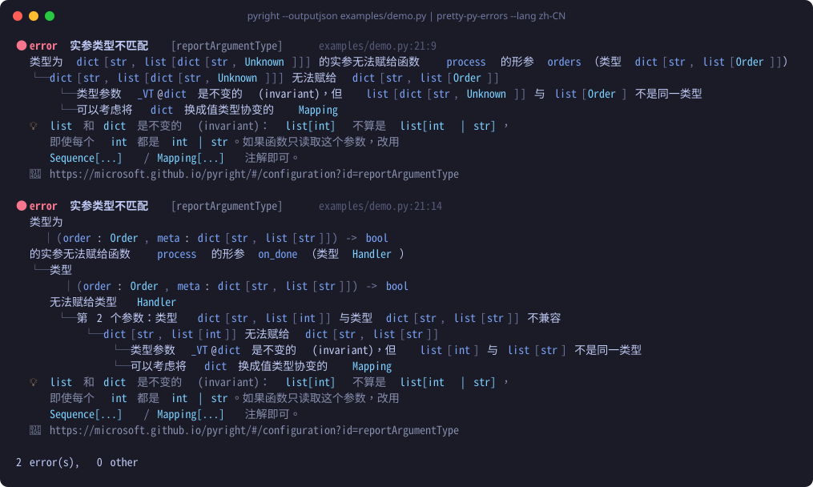
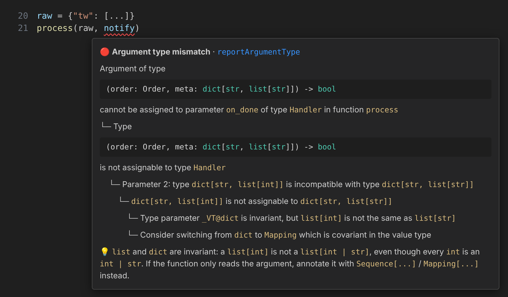

<div align="center">


# pretty-py-errors

**让 Python 类型错误变得易读：支持 VS Code 与终端。**

Pyright · Pylance · basedpyright · mypy

[](https://github.com/Sharkeeeeeee/pretty-py-errors/actions/workflows/ci.yml)
[](LICENSE)
[](CONTRIBUTING.md)

[English](README.md) · [繁體中文](README.zh-TW.md) · 简体中文 · [日本語](README.ja.md) · [한국어](README.ko.md)

</div>

---

## 目录

- [简介](#简介)
- [演示](#演示)
- [功能](#功能)
- [安装](#安装)
- [使用方法](#使用方法)
- [配置](#配置)
- [支持的类型检查器](#支持的类型检查器)
- [参与贡献](#参与贡献)
- [致谢](#致谢)
- [许可证](#许可证)

## 简介

Python 的类型检查器很强大，但错误信息很难读。一条 Pyright 错误可能是一整行嵌套的 `dict[str, list[tuple[...]]]`，后面再跟五层缩进的说明，真正的问题藏在最底下。

**pretty-py-errors** 会重新排版这些信息：

- 把过长的类型从句子中抽出来，按代码格式排版并高亮
- 把嵌套说明画成树状结构
- 每个错误都附上简短标题、修复提示和规则文档链接
- 支持**简体中文**、繁體中文、日本語、한국어显示

提供 **VS Code 扩展**（鼠标悬停即可显示）和 **CLI**（把 `pyright` 或 `mypy` 的输出通过管道传入即可）。

## 演示

### 原始输出



### 排版后（简体中文）

```bash
pyright --outputjson examples/demo.py | pretty-py-errors --lang zh-CN
```



### VS Code 悬停提示



<sub>悬停图片由扩展对同一条错误实际生成的 Markdown 渲染而成。</sub>

## 功能

| 功能 | VS Code | CLI |
| --- | :---: | :---: |
| 长类型独立成代码块并高亮 | ✅ | ✅ |
| 长类型按括号与 `\|` 联合类型自动换行 | ✅ | ✅ |
| 嵌套说明以树状显示 | ✅ | ✅ |
| 每条规则的简短标题（例如「实参类型不匹配」） | ✅ | ✅ |
| 常见错误的修复提示（`None` 检查、invariance、找不到包等） | ✅ | ✅ |
| 链接到 Pyright / mypy 的规则文档 | ✅ | ✅ |
| 简体中文、繁體中文、日本語、한국어翻译（70 种信息句式，以及所有规则标题与提示） | ✅ | ✅ |
| 支持 Pyright JSON／文本，以及 mypy 文本／`--pretty`／JSON 输出 | 不适用 | ✅ |
| Jupyter Notebook | ✅ | 不适用 |

## 安装

### VS Code 扩展

> 正在准备上架 Marketplace，目前请通过 `.vsix` 安装。

```bash
git clone https://github.com/Sharkeeeeeee/pretty-py-errors.git
cd pretty-py-errors
npm install
npx @vscode/vsce package --no-dependencies
code --install-extension pretty-py-errors-*.vsix
```

配合 **Pylance**（官方 Python 扩展自带）、**Pyright**、**basedpyright** 或 **Mypy Type Checker** 扩展即可使用，无需额外配置。

### CLI

> npm 包正在准备发布，目前请从源码运行。

```bash
git clone https://github.com/Sharkeeeeeee/pretty-py-errors.git
cd pretty-py-errors
npm install && npm run build
npm link
```

需要 Node.js 18 及以上版本。

## 使用方法

### VS Code

将鼠标悬停在类型检查器标出的波浪线上，悬停提示会显示排版后的说明，原始信息也会保留。

### CLI

```bash
pyright --outputjson | pretty-py-errors --lang zh-CN
pyright | pretty-py-errors
mypy . | pretty-py-errors
mypy -O json . | pretty-py-errors
pretty-py-errors report.json
```

| 参数 | 说明 |
| --- | --- |
| `--lang <code>` | 输出语言：`en`、`zh-TW`、`zh-CN`、`ja`、`ko`，默认根据 `LANG` 环境变量。 |
| `--no-color` | 关闭颜色，也支持 `NO_COLOR`。 |
| `--no-hint` | 不显示修复提示。 |
| `--width <n>` | 长类型的换行宽度（默认 `60`）。 |
| `-h, --help` | 显示帮助。 |

存在错误时 CLI 以退出码 `1` 结束，没有问题时以 `0` 结束，可直接用于 CI 和 pre-commit hook。参数错误时以退出码 `2` 结束。

## 配置

| 配置项 | 默认值 | 说明 |
| --- | --- | --- |
| `prettyPyErrors.enable` | `true` | 在悬停提示中显示排版后的错误。 |
| `prettyPyErrors.language` | `"auto"` | `auto`（跟随 VS Code 界面语言）、`en`、`zh-TW`、`zh-CN`、`ja` 或 `ko`。 |
| `prettyPyErrors.showHints` | `true` | 显示常见错误的修复提示。 |
| `prettyPyErrors.inlineTypeLimit` | `40` | 超过此长度的类型会独立成代码块。 |
| `prettyPyErrors.typeWidth` | `60` | 长类型的换行宽度。 |

## 支持的类型检查器

Pylance、Pyright、basedpyright、mypy。详见[英文说明](README.md#supported-checkers)。

## 参与贡献

欢迎贡献，尤其是新的翻译句式和修复提示。提交 Pull Request 前请先阅读 [CONTRIBUTING.md](CONTRIBUTING.md)。

## 致谢

本项目的灵感来自 [Yoav Balasiano](https://github.com/yoavbls) 的 [**pretty-ts-errors**](https://github.com/yoavbls/pretty-ts-errors)，它为 TypeScript 做了同样的事。pretty-py-errors 是为 Python 生态独立实现的项目，没有共用任何代码。

## 许可证

[MIT](LICENSE) © Sharkeeeeeee
