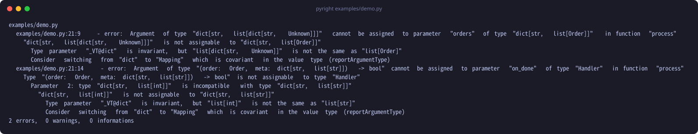
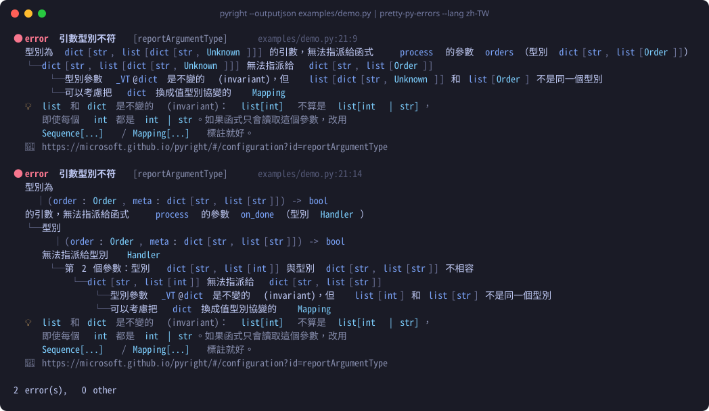
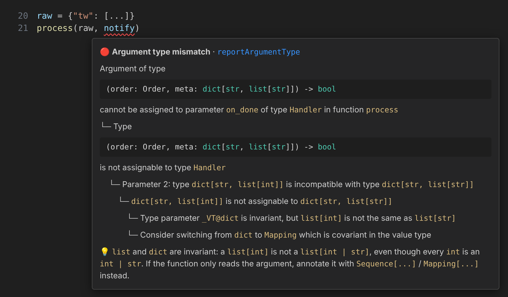

<div align="center">


# pretty-py-errors

**讓 Python 型別錯誤變得好讀：支援 VS Code 與終端機。**

Pyright · Pylance · basedpyright · mypy

[](https://github.com/Sharkeeeeeee/pretty-py-errors/actions/workflows/ci.yml)
[](LICENSE)
[](CONTRIBUTING.md)

[English](README.md) · 繁體中文 · [简体中文](README.zh-CN.md) · [日本語](README.ja.md) · [한국어](README.ko.md)

</div>

---

## 目錄

- [簡介](#簡介)
- [展示](#展示)
- [功能](#功能)
- [安裝](#安裝)
- [使用方式](#使用方式)
- [設定](#設定)
- [支援的型別檢查器](#支援的型別檢查器)
- [參與貢獻](#參與貢獻)
- [致謝](#致謝)
- [授權](#授權)

## 簡介

Python 的型別檢查器很強大，但錯誤訊息很難讀。一則 Pyright 錯誤可能是一整行巢狀的 `dict[str, list[tuple[...]]]`，後面再接五層縮排的說明，真正的問題藏在最底下。

**pretty-py-errors** 會重新排版這些訊息：

- 把過長的型別從句子中抽出來，用程式碼的格式排版並上色
- 把巢狀說明畫成樹狀結構
- 每個錯誤都附上簡短標題、修正提示和規則文件連結
- 全部可以用**繁體中文、简体中文、日本語、한국어**顯示

提供 **VS Code 擴充套件**（滑鼠移上去就會顯示）與 **CLI**（把 `pyright` 或 `mypy` 的輸出 pipe 進來即可）。

## 展示

### 原始輸出



### 排版後（繁體中文）

```bash
pyright --outputjson examples/demo.py | pretty-py-errors --lang zh-TW
```



### VS Code 懸停提示



<sub>懸停圖片由擴充套件對同一則錯誤實際產生的 Markdown 繪製。</sub>

所有截圖都是用 [`test/fixtures`](test/fixtures) 裡真實的 Pyright 輸出，透過 `npm run docs` 產生。

## 功能

| 功能 | VS Code | CLI |
| --- | :---: | :---: |
| 長型別獨立成區塊並上色 | ✅ | ✅ |
| 長型別依括號與 `\|` 聯集自動換行 | ✅ | ✅ |
| 巢狀說明以樹狀顯示 | ✅ | ✅ |
| 每條規則的簡短標題（例如「引數型別不符」） | ✅ | ✅ |
| 常見錯誤的修正提示（`None` 檢查、invariance、找不到套件⋯） | ✅ | ✅ |
| 連到 Pyright / mypy 的規則文件 | ✅ | ✅ |
| 繁體中文、简体中文、日本語、한국어翻譯（70 種訊息句型，以及所有規則標題與提示） | ✅ | ✅ |
| 支援 Pyright JSON、Pyright 文字與 mypy 文字輸出 | 不適用 | ✅ |
| Jupyter Notebook | ✅ | 不適用 |

## 安裝

### VS Code 擴充套件

> Marketplace 上架準備中，目前請用 `.vsix` 安裝。

```bash
git clone https://github.com/Sharkeeeeeee/pretty-py-errors.git
cd pretty-py-errors
npm install
npx @vscode/vsce package --no-dependencies
code --install-extension pretty-py-errors-*.vsix
```

搭配 **Pylance**（官方 Python 擴充套件內建）、**Pyright**、**basedpyright** 或 **Mypy Type Checker** 擴充套件即可使用，不需要額外設定。

### CLI

> npm 套件發布準備中，目前請從原始碼執行。

```bash
git clone https://github.com/Sharkeeeeeee/pretty-py-errors.git
cd pretty-py-errors
npm install && npm run build
npm link
```

需要 Node.js 18 以上。

## 使用方式

### VS Code

把滑鼠移到型別檢查器標示的波浪線上，懸停提示會顯示排版後的說明，原始訊息也會一併保留。

### CLI

```bash
pyright --outputjson | pretty-py-errors --lang zh-TW
pyright | pretty-py-errors
mypy . | pretty-py-errors
pretty-py-errors report.json
```

| 參數 | 說明 |
| --- | --- |
| `--lang <code>` | 輸出語言：`en`、`zh-TW`、`zh-CN`、`ja`、`ko`，預設依照 `LANG` 環境變數。 |
| `--no-color` | 關閉顏色，也支援 `NO_COLOR`。 |
| `--no-hint` | 不顯示修正提示。 |
| `--width <n>` | 長型別的換行寬度（預設 `60`）。 |
| `-h, --help` | 顯示說明。 |

只要有任何錯誤，CLI 就會以代碼 `1` 結束，可直接用在 CI 和 pre-commit hook。

## 設定

| 設定 | 預設值 | 說明 |
| --- | --- | --- |
| `prettyPyErrors.enable` | `true` | 在懸停提示中顯示排版後的錯誤。 |
| `prettyPyErrors.language` | `"auto"` | `auto`（跟隨 VS Code 介面語言）、`en`、`zh-TW`、`zh-CN`、`ja` 或 `ko`。 |
| `prettyPyErrors.showHints` | `true` | 顯示常見錯誤的修正提示。 |
| `prettyPyErrors.inlineTypeLimit` | `40` | 超過這個長度的型別會獨立成程式碼區塊。 |
| `prettyPyErrors.typeWidth` | `60` | 長型別的換行寬度。 |

## 支援的型別檢查器

Pylance、Pyright、basedpyright、mypy。詳見[英文版說明](README.md#supported-checkers)。

## 參與貢獻

歡迎貢獻，尤其是新的翻譯句型和修正提示。送出 Pull Request 前請先閱讀 [CONTRIBUTING.md](CONTRIBUTING.md)。

## 致謝

本專案的靈感來自 [Yoav Balasiano](https://github.com/yoavbls) 的 [**pretty-ts-errors**](https://github.com/yoavbls/pretty-ts-errors)，它為 TypeScript 做了同樣的事。pretty-py-errors 是為 Python 生態系獨立實作的專案，沒有共用任何程式碼。

## 授權

[MIT](LICENSE) © Sharkeeeeeee
